# 従来のルールベースは本当に安全か？ — Sumi

学校の書類を提出するとき、確認者に原文を見せずに「決めた言葉を含まない」と確かめられるでしょうか。Sumiは、規則を守ったと人が宣言するだけでなく、**決めた条件の実行結果を相手が検証できる形にする**研究用の試作です。学校での必要性や使いやすさは仮説であり、利用者への聞き取りはまだ行っていません。

## 画面で見る Sumi

以下はブラウザで実際に操作した画面です。入力・回答はすべて架空のデータです。画面の表示や集計結果は、端末全体の安全性や実在する回答の秘密を保証するものではありません。

### はじめに・文書の証明

| ホーム | 文書の条件を証明する |
| --- | --- |
| 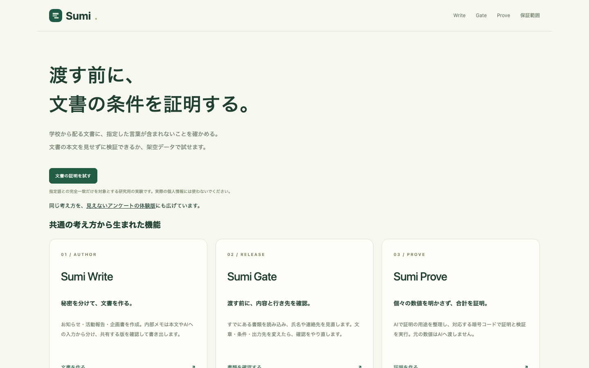 | 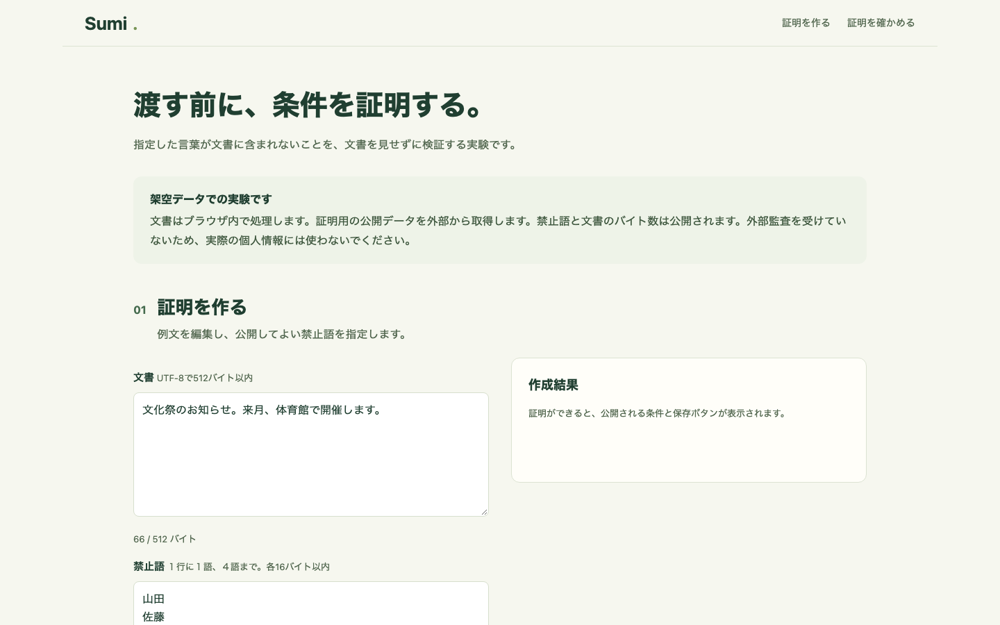 |
| 各機能と保証範囲へ進みます。 | 架空の文書と禁止語を入力し、条件の証明を作成・検証します。 |

### Sumi Write — 本文と内部メモを分ける

| 文書の作成 | 公開する版の確認 |
| --- | --- |
| 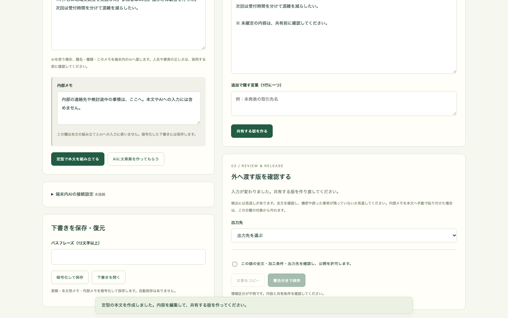 | 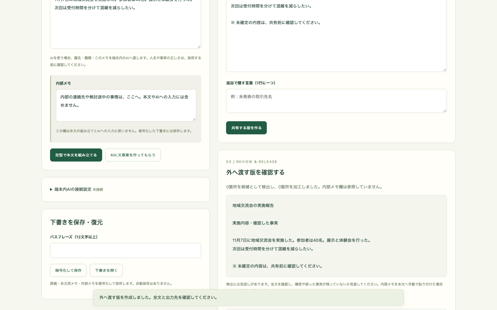 |
| 本文用の情報から定型文を組み立てます。内部メモは本文生成に渡しません。 | 加工後の全文と出力先を確認してから、コピーまたは署名付き保存を行います。 |

### Sumi Gate — 共有前に加工する

| 元の書類と加工条件 | 加工後の確認 | 文章の集計 |
| --- | --- | --- |
| 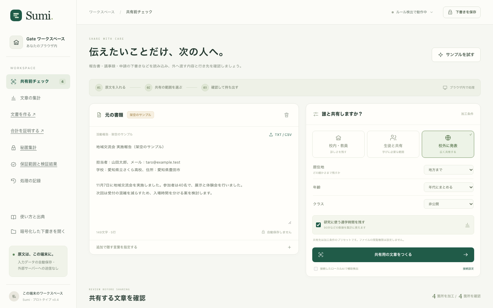 | 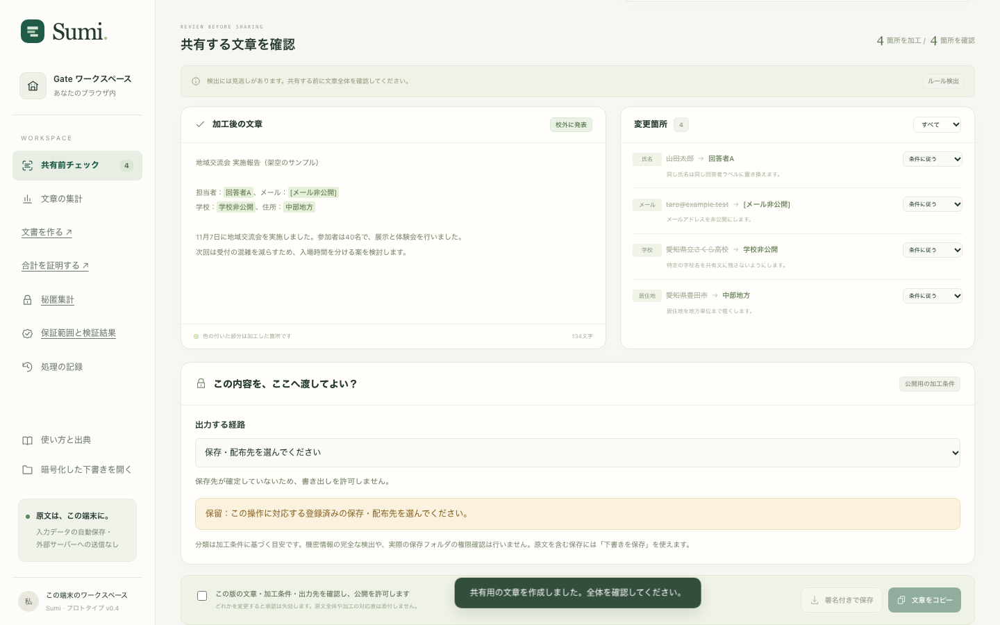 | 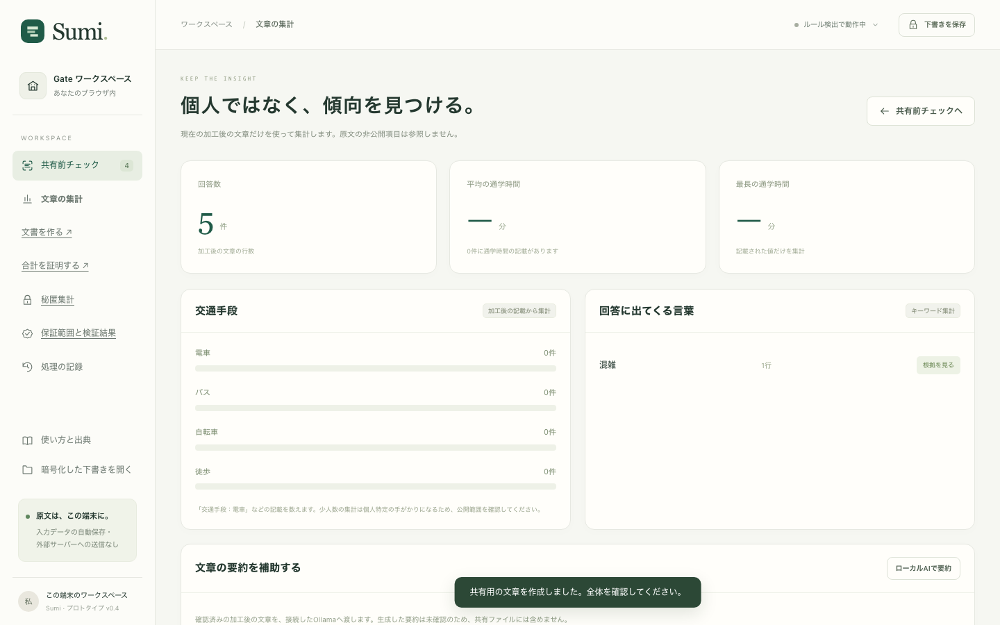 |
| 架空の書類と共有範囲を選びます。 | 検出候補と加工後の文章を確認します。 | 元の文章から得た集計を確認します。 |

検出には見逃しがあります。公開前に人が全文を確認する必要があります。

### Sumi Prove・見えないアンケート

| 数値の証明 | アンケートへの回答 | 架空回答の集計 |
| --- | --- | --- |
| 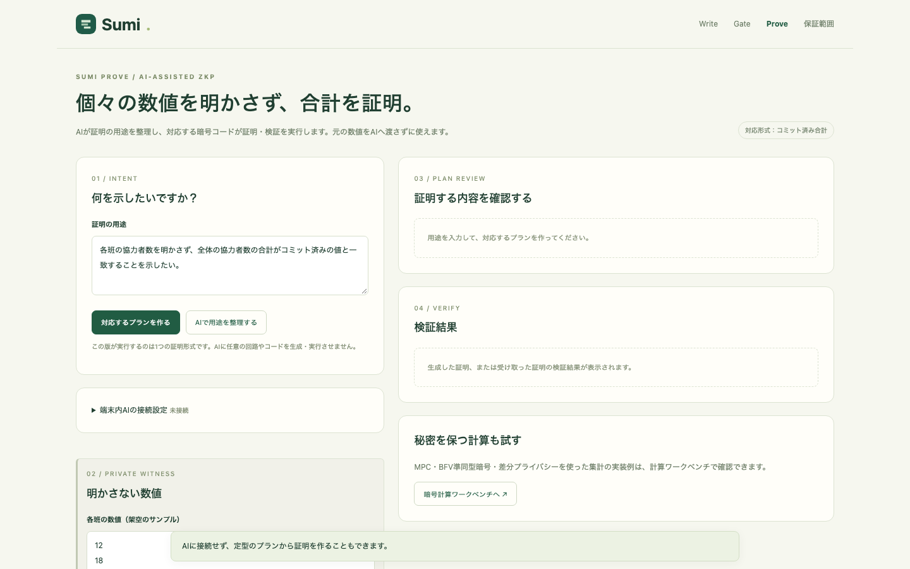 | 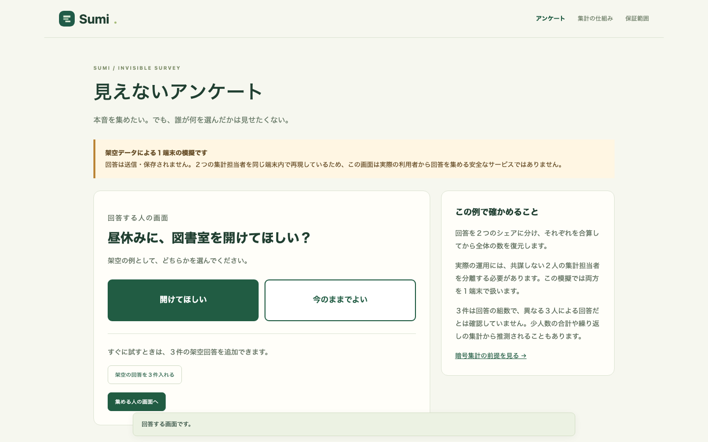 | 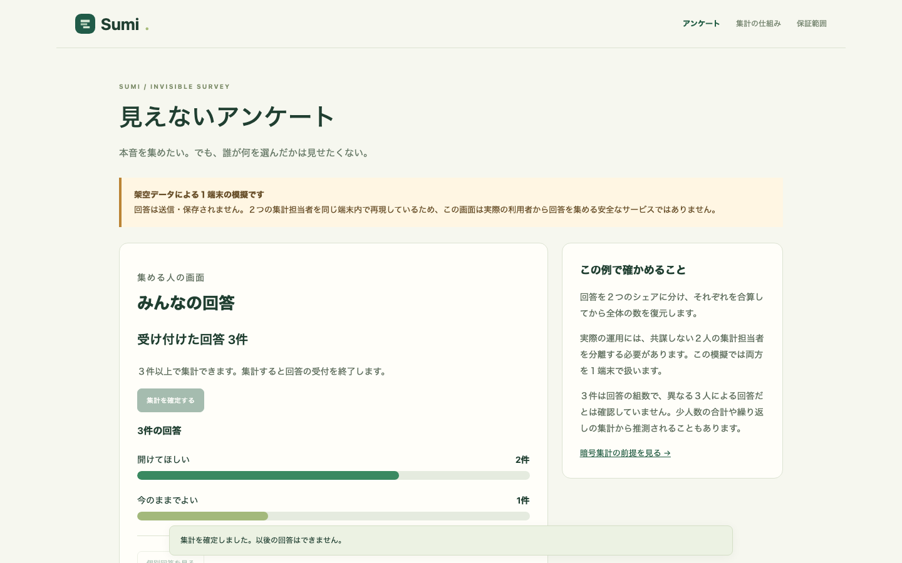 |
| 個々の数値を明かさず、合計との関係を証明します。 | 二択の回答と３件の架空回答を試せます。 | 個別回答を表示せず合計を示す模擬です。公開版は１端末で動き、回答の秘密を守る実運用版ではありません。 |

### 検証結果と Lean モデル

| 保証範囲 | 認可・情報流モデル | エージェント判定モデル |
| --- | --- | --- |
| 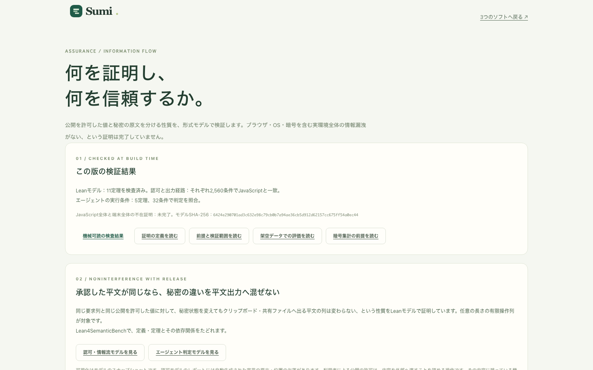 | 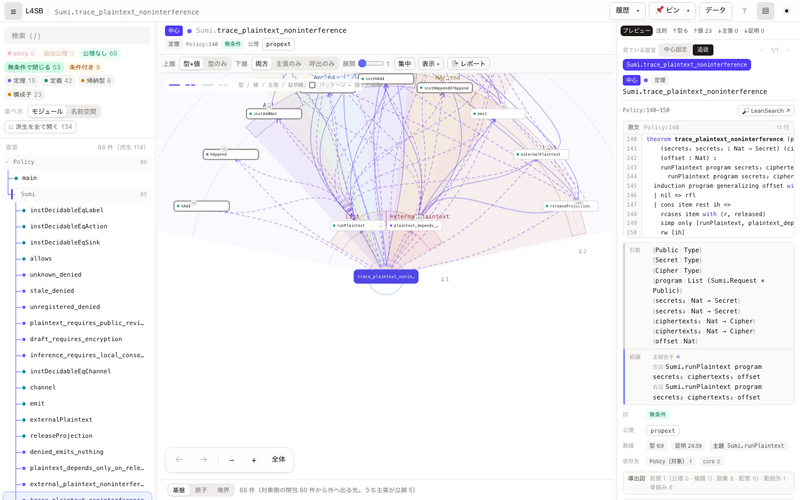 | 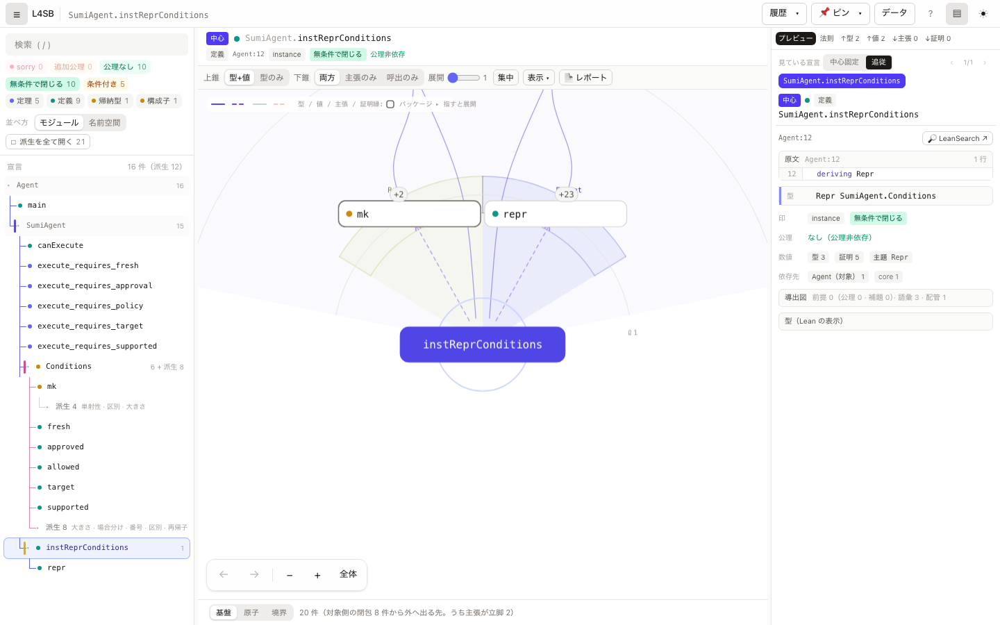 |
| 検査結果と信頼する前提を確認します。 | 定義・定理と依存関係をたどれます。 | エージェントの実行条件をたどれます。 |

Lean の表示はモデルのスナップショットです。認可モデルの一部の自動生成宣言には原文・位置情報の欠落があります。[可視化の説明](sumi/visualization/lean/README.md)を参照してください。

## 応募資料

- [応募用紙（PowerPoint）：ZKが必要な理由とアクター別の解決](sumi/submission/Sumi_応募用紙_第５回_ZKの必要性.pptx)
- [実画面のデモ動画（約75秒）](sumi/submission/文書の証明_学校別設定デモ.mp4)
- [審査向けデモ手順](sumi/submission/審査向けデモ手順.md)

応募用紙は依頼に合わせて第５回と記載しています。2026年11月9日に確認した[公式サイト](https://zenjyocon.jp/contest2026)は第４回を募集中と案内しており、第５回の正式な指定用紙との一致は未確認です。
GitHubでは PowerPoint を直接表示できないため、ダウンロードして開いてください。

## ブラウザで試す

[比較から各機能までをたどる Sumi のデモを見る](https://sururu-k.github.io/zenjoukon-2/showcase/)：先頭だけの検査と全文検索を比較し、文書証明・各機能・検証範囲を紹介します。画面演出と実際の機能は区別して表示しています。

[文書の条件を証明するデモを開く](https://sururu-k.github.io/zenjoukon-2/document-proof/)（インストール不要・架空データ専用）

1. 例文と公開してよい禁止語を確認し、「証明を作成する」を押します。
2. 作成された公開条件を確認し、証明と公開条件をそれぞれ保存します。
3. 検証者側の画面で証明ファイルと、**別の信頼できる経路で確認した期待条件**のファイルをそれぞれ選び、検証します。デモでは同じ画面に貼り付けて操作を試せます。
4. 期待条件の文書長などを変えて再検証すると、不一致として拒否されます。

初回は証明用の公開パラメータを外部から取得し、計算には時間と数百 MB のメモリを使います。証明処理はブラウザ内で実行します。文書の長さ・禁止語・コミットメントは公開されます。開封情報に含まれるランダム値は非公開で管理してください。

**対象はUTF-8で512バイト以内の文書と、最大４語・各16バイト以内の指定語の完全一致です。** 表記ゆれ、画像、指定していない個人情報や端末全体の漏洩を検査するものではありません。回路とツールは外部監査を受けていないため、実際の個人情報には使わないでください。

## １つの主張から広げる

「必要な情報だけを渡し、決めた条件を検証する」という考え方を、異なる場面に応用しています。これらは同じ暗号プロトコルを共有する製品ではなく、実装と前提が異なります。

| 試作 | 利用場面 | 現在の範囲 |
| --- | --- | --- |
| 文書の条件の証明 | 提出前に、指定語がないことを原文を見せずに確認する | NoirとBarretenbergによるゼロ知識証明を公開デモで生成・検証 |
| [Sumi Write](https://sururu-k.github.io/zenjoukon-2/writer.html) | 本文案と内部メモを分けて文書を作る | 内部メモは本文生成に渡さない。本文欄への機密入力は防げない |
| [Sumi Gate](https://sururu-k.github.io/zenjoukon-2/gate.html) | 書類の配布前に加工と出力先を確認する | 検出漏れがあり、人の確認が必要 |
| [Sumi Prove](https://sururu-k.github.io/zenjoukon-2/proof-studio.html) | 個々の数値を明かさず合計との関係を示す | 数値が実際の事実であることは証明しない |
| [見えないアンケート](https://sururu-k.github.io/zenjoukon-2/survey-demo.html) | 個別回答を見ずに合計する考え方を試す | 公開版は１端末の模擬で、実際の回答の秘密は守れない |

[架空学校の共通設定例](sumi/src/school-policy.example.json)には、共有範囲の初期プリセット、証明の初期禁止語、学校向け点検項目をまとめています。学校ごとの認証・署名・配布や全製品への強制適用は未実装です。

エージェント向けの端末試作でも、共通JSONの指定語と追加語を渡す前に加工します。ただし検出漏れはあり得るため、人が加工版を確認する必要があります。[構成と制約](sumi/school-backend/README.md)を参照してください。

## 根拠と限界

文書証明は、秘密の文書とランダム値を公開コミットメントに結び付け、指定語が全文のどの位置にも一致しないことを回路で検査します。検証者は証明内の条件を無確認で信じず、期待する条件と照合します。ただし、期待条件や回路の真正性、証明と実際に提出された文書の対応は別途確認が必要です。

WriteやGateで用いる認可・情報流モデルに加え、編集・出力先変更による承認失効と出力を表す状態遷移モデルをLeanで検査しています。この状態遷移モデルと実行コードの対応はまだ証明していません。JavaScript全体やブラウザ・OSを含む漏洩全体の不在も証明したものではありません。ゼロ知識証明や文書に関する既存研究があり、方式そのものが新しいという主張もしていません。[保証範囲](sumi/ASSURANCE.md)と[文書証明の実験](sumi/experiments/browser-document-proof/README.md)に前提と再現方法を記載しています。

[比較実験](sumi/EVALUATION.md#テスト例と文書全体の比較)では、意図的に不完全にした検査が少数の例を通過しても後半の指定語を見落とすことと、今回の回路も別表記を扱えないことを再現できます。

[認可・情報流モデルの可視化](https://sururu-k.github.io/zenjoukon-2/lean/policy/)と[エージェント判定の可視化](https://sururu-k.github.io/zenjoukon-2/lean/agent/)では、Leanの定義・定理と依存関係を閲覧できます。認可側は原文・位置情報に関する２項目がツールの検査で不合格です。対象と限界は[説明](sumi/visualization/lean/README.md)を参照してください。

## 検証と公開

GitHub Actionsは既存の自動テストとLeanモデルの検証に加え、文書証明のブラウザ上での作成・検証をテストし、成功時にGitHub Pagesへ配置します。回路の証明対象や実利用での安全性を、テストの成功だけで保証するものではありません。開発方法は [sumi/README.md](sumi/README.md) を参照してください。

## ローカルで開く

Lean 4（`sumi/formal/lean-toolchain` に指定した版）と Node.js を用意し、`sumi` で `npm ci`、続いて `npm run dev` を実行します。表示されたローカル URL の「保証範囲」から Lean の可視化も開けます。文書証明の画面は別途 [ビルド手順](sumi/experiments/browser-document-proof/README.md)に従って配置します。

スクリーンショットはビルド済み `dist` をポート 4173 で配信し、`sumi` で `node scripts/capture-readme.mjs` を実行すると更新できます。Playwright 用 Chromium と文書証明画面の別ビルドが必要です。
